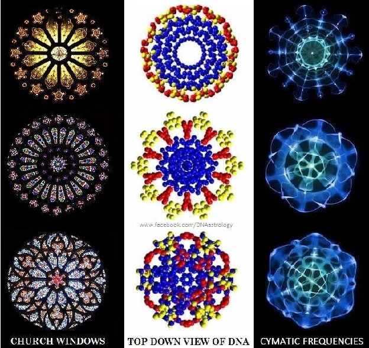

# Resonance — Game Design Document

*(working title — other candidates: Cadence, Ballad, Cadenza, Cymatica)*

## 1. Elevator Pitch

A pixel-art 2D metroidvania about a boy who inherits his grandfather's staff — part walking stick, part flute, part weapon — and must relearn the songs that once kept the world's curses at bay. Movement and platforming lead the experience, punctuated by large boss fights and environmental puzzles, in the spirit of *Hollow Knight*, *Celeste*, *Fez*, *Tunic*, and *Rain World*. The core hook: the instrument that heals the land is also the key to every hidden secret, and the shapes those songs make in the world are a language the player has to learn by ear and by eye, never by text.

## 2. Inspirations & References

**Gameplay:** Ocarina of Time, Breath of the Wild, Shadow of the Colossus, Prince of Persia, God of War, Hollow Knight, Celeste, Fez, Tunic, Rain World, Cocoon

**Mood/Music:** Ocarina of Time intro, Hyper Light Drifter (Disasterpiece score), AlkaKrab tracks — *Unexplored Fields*, *Looters at the Port*, *Battle of the Skies / Epic Quest*, *Emptiness of Life*

**Music Genre:** Chill Synth / Chill and Nostalgic Synthwave / Chillwave / Retrowave.

**Artists to keep in mind:**

* (music) Emil Rottmayer — https://linktr.ee/emilrottmayer

## 3. Visual Style

* Primary: pixel art sidescroller, similar to *Celeste*
* Penusbmic Pixel Art — https://penusbmic.itch.io/
* Alternate direction under consideration: low-poly elevated third-person, similar to *Cocoon*
* Title font: Alder Road (Typeverything) — sophisticated yet decaying/crumbling, matching the world's fall from grace

## 4. World & Story

### Premise

The player character has only his grandfather left — mother, father, siblings have all left or died. The grandfather is seen throughout the intro walking with a staff. After a short tutorial (jump, climb, crawl, kick, punch) confined to the home village, the grandfather is revealed to be dying. He hands over the staff, explaining cryptically that it's "much more than a walking stick." The new long-jump it grants is the literal and thematic key that lets the player leave home — there's no family left to keep him there.

### Opening scene

Fade in on *Unexplored Fields* (AlkaKrab). Character sits on a tree branch/rock, gazing at the distant White City, hair and scarf in the wind, sand blowing. A seamless transition carries the player from this cinematic into the first playable area as the character climbs down and the camera pulls back. To the left, a small animal hums a tune on a branch — the player can't copy it yet (no staff, no knowledge that copying tunes does anything). This is the first cymatic/musical secret in the game, planted before the player has any tools to understand it.

### Villain's motive

Every temple carries a curse that drains energy and resources from its region and reroutes them to the White City's central pillar. Entering each dungeon is about severing that drain and weakening the White City's hold.

### The White City (allegory for Washington, D.C.)

Sophisticated, clean, undamaged — in stark contrast to the decaying regions around it. A gleaming white pillar (echoing the Washington Monument) rises above the clouds at its center. The city's baths and fountains are full and beautiful. Its people are largely religious zealots devoted to the pillar's "church," disconnected from the suffering their prosperity causes, and often not even aware their comfort *is* the cause. Some surrounding-region residents share this faith; a few see the truth but are powerless to act.

The market and approach to the pillar are safe; the interior turns hostile with guards and traps.

**Final boss:** fought atop a shallow pool at the pillar's peak. The antagonist floats above the player, visible only through his reflection in the water — moonlight forms a "halo" behind his head, inverting the usual sun-halo iconography associated with holiness.

## 5. World Map & Regions

Entire map is a concentric circular cymatic shape.

**Possible names for the world:** Cymatica, Cymatia, Cymalia, Cymillia, Cymilla.

**Possible names:** Cymatica, Cymatia, Cymalia, Cymillia, Cymilla

### Desert / Barren Sea / Sunken Ship *(starting region)*

Once a prosperous sea port, now a desolate expanse — the largest region in the game. Sunken ship, sand-swallowed lighthouse, and a wind-inflated balloon for long-distance desert travel are its landmarks. Peaceful but inhospitable; sparsely populated; sandstorms; a visible galaxy at night.

* **Music:** Distant Horizons
* **Hazards:** quicksand/sandpits, duneslides ("snowboarding" down large dunes), sand caverns/prisons
* **Temple:** the Sunken Ship. Final boss has the ship sinking into the sand in real time — the player retraces every room just cleared, but a newly-earned ability (possibly staff-teleport) changes how those rooms are traversed the second time. Open question: should this be the *last* of the three elemental temples, for a full-circle structure?

### Old Forest / Dark Woods / Swamp / Ziggurat

Formerly lush and green, now black-barked and gnarled, stripped of vegetation — deliberately horror-inflected. Mesoamerican-style architecture culminates in a volcano/ziggurat temple.

* **Music:** Looters at the Port
* **Hazards:** falling tree limbs (platforming hazard)
* **Temple:** Ziggurat / Volcano

### Mountains / Ice World / Mine

* **Hazards:** bottomless pits, ice-slide hazards, Mario-style crushing pillars
* **Temple:** a mine, themed around mineral resources
* **Music:** Battle of the Skies / Epic Quest (final boss)

### Central Hub — White City / Main Pillar

See World & Story above.

* **Hazards:** spike traps, spinning blades, armed guards
* **Final boss beats:** "Power of Fear" (pre-boss chamber) → "Hiding in the Darkness" (confrontation)

### Spirit Plain

Reached after each temple boss is defeated; the staff is upgraded here with a new divine ability used to escape the temple.

A yellow/pink/purple gradient makes sky and ground indistinguishable. Functions as the game's fast-travel hub — once a dungeon and its holy sites are unlocked, the Spirit Plain connects them all.

Possibly moving psychedelic cymatic patterns similar to the cymatik.app.

*Reference: church rose windows, DNA seen top-down and cymatic frequency patterns share the same radial structure.*

To enter the Spirit Plain, you must play the associated song for that region at the holy spot — chromatic aberration becomes more pronounced upon playing the holy melody until eventually taking over the entire screen.

Use church symbology/imagery — stained glass and ancient architecture cymatic designs.

* **Music:** Emptiness of Life

### Connecting environments

The transitional spaces between regions are the game's platforming/survival core, styled heavily after *Rain World*. Hazards include hostile creatures, platforming challenges, and the environment itself turning lethal on a timer (desert heat at midday, mountain cold at night, forest flooding in heavy rain). Once a region's temple is beaten, its home turf becomes safe and its resident culture's "plague-handling" ways take over — but the connecting routes between regions stay dangerous throughout the game. First pass through a connector is about survival; after the relevant boss falls, certain secrets in that same space open up and the return trip is about exploration instead.

## 6. Core Gameplay Systems

### The staff

The central mechanic: one tool that is simultaneously a melee weapon, a throwable (sticks in walls for platforming, can be called back or left until you leave the room), a pole-vault for charge-jumps, and — when held via RB — a flute. It converts contexts instantly: combat, traversal, and music all run through the same object, so upgrading it upgrades everything the player can do.

**Upgrade path:** throw → magic pulse on thrown staff (possible air dash alongside) → teleport-to-staff → possible "crystal dash" (Hollow Knight-style). Each temple's entry point is sealed behind the specific upgrade earned in the previous one — map and armor help, but only the divine ability is a hard requirement.

### Combat

Concentrated mainly in temples and boss fights. Each region teaches a distinct fighting style or ability tied to its temple, expanding combat options as new regions open.

The boy starts with his fists: a two-hit jab-cross combo on Y. A second press during the jab chains into the cross, and presses are buffered so the combo can be played on the beat rather than in a tight timing window. Each punch commits the feet until the fist has landed and retracted, then movement or a jump cancels the follow-through. Punches work in the air too, where every press is a cross rather than a jab. The jump arc and air steering carry on through the swing, so a punch never stalls the player mid-jump, and landing mid-punch just plants the feet for the rest of it. Grabbing lives on its own button (RB), so Y is purely for attacking.

#### Boss Fights

Each boss fight is divided into two distinct sections — the fight and the escape. Combat and then platforming. Hollow Knight and then Ori.

### Traversal & movement

Climbing and wall-shimmying (Fez-inspired), crouch-to-crawl, hold-crouch-to-sit, charge jump (staff required), air dash, and eventually teleport-to-thrown-staff. Between-region routes emphasize this system hardest.

**Prototyped (test room):**
- **Dash.** A dashes, in the air or on the ground while moving, so a run can burst forward without hopping first. A standing still on the ground does nothing, and Down+A rolls, or slides out of a sprint (see below). A dash out of a sprinting takeoff, with ZR still held, runs a little longer, about 4 tiles instead of 3, so carrying momentum into it pays off. Holding ZR through the dash flows straight into a sprint without a second input. After each dash there's a real cooldown (0.8s for now, counted from when the dash ends; the glow fades over exactly that time, so it shows when the next dash is ready) before the next, on the ground too, so dashes can't be chained back to back: the abilities should feel powerful but be used with intention, with cooldowns that are a little punishing. Before a dash or dive fires there's a brief wind-up (0.2s): the player hangs still, frozen on the current frame, and brightens with a blue-white glow that holds for the rest of the dash or dive. After an air dash the glow stays on until the dash is refilled, so a spent dash is visible at a glance; it fades out over a few frames on landing, so the moves read as magic being gathered. It stands in for a proper power-up animation. The dash goes left or right only (left or right must be held; neutral or Up does nothing), covers about 3 tiles (4 from a sprint), and suspends gravity. The player gets one air dash per jump, refilled only on the ground. Touching or sliding down a wall, climbing, hanging from a ledge or catching a rope doesn't refill it. Keeping ZR held after the dash keeps the player sprinting at 1.5x run speed in the held direction, so a dash flows straight into a sprint. The sprint only carries into the air from a sprinting takeoff; holding the button during an ordinary jump adds nothing.
- **Refill and bounce diamonds.** Yellow diamonds float in the air, each about twice the size of the boy's head. Touching one makes it burst like a small explosion (it swells to twice its size and fades out in under half a second), and it comes back after about 5 seconds (a faint outline marks where). A refill diamond (marked %) gives back the spent air dash and one use of the air ability limit (below), so it extends a chain by a step rather than resetting it like the ground. Falling or jumping into it doesn't break his stride: the glow of a spent dash fades back to normal and the next dash is ready at once, so a route can ask for a second dash before landing. Dashing into it is a slingshot: he freezes for 0.8s, then shoots on the way he was dashing for twice a dash's distance, with the dash still refilled for afterwards. It only reacts while the dash can't be used (spent, or the limit reached), so brushing past it with the dash ready doesn't waste it. A bounce diamond (marked &) always reacts: it freezes him in place for 0.8s, then launches him straight up twice as high as a full jump, and refills the dash too. Releasing jump doesn't cut the launch short. The glyphs tell the two apart without relying on colour. They're Celeste's refill crystals and springs; the bounce's pause keeps the rhythm readable.
- **Dive.** Dashing with straight Down held in the air drops the player straight to the ground faster than a fall, like Hollow Knight's Desolate Dive. It can't be steered or cancelled, and on landing the player holds a deep crouch for a heavy 0.8s recovery before standing up. Down with a side held is still a sideways dash. It works once per trip through the air, and counts toward the air ability limit (below), so a dash can go into a dive once the limit allows two or more. On the ground Down + A rolls instead (below). Impact damage and screen shake come later (the shake will respect the reduced-motion toggle).
- **Hard landing.** A long fall (for now, about the height of the test room's tallest climbable column, 14 tiles) lands with the same heavy crouch and 0.8s recovery as the dive, but without the glow. It makes big drops feel weighty and gives a reason to climb down rather than jump. Grabbing or sliding down a wall on the way breaks the fall, so the drop is measured from the last thing the player was holding on to.
- **Charged jump.** Holding Down and pressing jump on the ground crouches and gathers the jump for as long as jump is held; letting go fires it. Down only has to be held for the press. A tap is a normal jump and costs nothing; past a short hold (0.15s) it counts as an air ability (below), and the height grows evenly with the hold up to twice a normal jump's at 1.6s, so a part charge gives a part jump. The boy is planted while it charges. He holds still in one crouched frame and glows brighter as it builds, and once it's full the glow keeps pulsing (twice a second, a smooth swell rather than a hard flash, under the photosensitivity limit) until he lets go, so the timing reads without counting (a visual cue, not just feel). Firing on release means it can't be cut short. It's the planned staff-gated charge jump, prototyped without the staff for now.
- **Wall slide and wall jump.** Holding toward a wall slows the fall, and jumping kicks off the wall (Celeste/Hollow Knight). Each jump in a trip through the air is smaller than the last. Jumping from the ground (or straight off a climb or a wall run, which gain height honestly) is a full jump; the first wall jump after it gets 0.6 of the height, the next only 0.2 (the tired one), and after that jump does nothing against a wall until he lands. Jumping while sliding down a wall is always a smaller jump (0.4 of the height) that never runs out but can never take him above his last sliding jump, so a shaft between two walls can be worked down by jumping from side to side but never climbed. Climbing or wall running resets the count. Wall jumping wasn't in the original list. It's in as a feel test, and whether it stays as a base move, becomes an upgrade, or gets folded into Fez-style climbing is still open.
- **Ledge grab and climb.** Holding grab (RB) while falling at a ledge catches it, and without grab the player falls past. Pressing up or jump climbs. Holding toward the wall doesn't, so mounting stays a deliberate choice. Pressing away or down, or releasing grab, drops. This is the "climb" from the tutorial list in its simplest form, and Fez-style wall shimmying can build on the same hang state.
- **Wall climb (Celeste-style).** Only marked surfaces can be climbed, so climbing routes are a level-design choice rather than every wall in the game. Wall slides, wall jumps, wall runs and ledge grabs still work on any wall. In the test room every climbable surface is a flat green strip; final art needs a texture or shape that marks it as well as colour, so it reads for colour-blind players. Hold grab (RB) on a climbable surface to cling; from the ground, attach to it and press Up. Up climbs and Down climbs back down at the same steady pace (not a slide). There's no climbing stamina for now: the player can hang on for as long as grab is held. Jumping off the wall is always a wall jump, away from it. Unlike Celeste there is no climb jump straight up the wall: spamming one breaks the rhythm, and the game aims to be more rhythmic than Celeste, so climbing up stays a steady, deliberate pace. Reaching the top hands off to the ledge hang. This is the base for the Fez-style climbing and shimmying above. **Handholds** are single grip points (small pegs, drawn differently from climbable strips so they read by shape): the boy can catch and hang from one but not climb along it, and the jump off one is a full jump like off any climb. A ladder of them, each just within a best jump of the last, turns an unclimbable shaft into a precise route upward. The test room's A6/B1 shaft has one, starting where the best jump off a wall run reaches.
- **Attach (push/pull).** On the ground, pressing and holding grab (RB) while standing against a wall holds on to it: the boy braces in a push-pull stance. Holding toward the wall plays the push, holding away plays the pull, and the feet stay planted. Any wall works, but against an ordinary wall it's only the pose. Movable blocks, marked with a blue bar on each side, actually move: holding toward pushes the block and holding away pulls it, slowly and evenly so it reads as effort. Walking into a block pushes it too, without grabbing; grabbing is only needed to pull. Sprinting into one doesn't push it: the boy runs up its face and vaults on top, as with any low wall. A block falls if it's pushed off a ledge. Up on a climbable wall starts the climb; letting go of RB or jumping ends it.
- **Slide jump.** Jumping out of a slide (the sprint slide, or the slide a slope runs out into, or just after sliding off a ledge) is a low long jump with the somersault: about 60% of a normal jump's height, with an extra push on top of the slide's speed, kept until landing. Holding forward or nothing doesn't bleed it off; only steering back against it does. It makes the slide a way into long jumps, not just under gaps.
- **Crouch, crawl, roll and slide.** Holding Down on the ground crouches, and Down with a direction crawls slowly. All three of crouch, roll and slide make the body small enough to fit through a one-tile gap, so low tunnels are crawlspaces; the boy only stands back up once there's room. A while crouched (Down held, or stuck low in a tunnel) rolls: a quick, committed burst of about 3 tiles in the held direction (or the way the boy faces), which a jump can cancel. Straight out of a sprint (ZR), Down+A slides instead, covering about 4 tiles. There's only a brief window (0.2s) after the sprint ends to do it, so the slide is something a sprint flows into; from a crawl or a walk, Down+A is always the roll. It bleeds its speed off before settling into a crouch, so a sprint can shoot straight into a tunnel, and a jump out of a slide keeps the speed. Without Down, A is the dash, on the ground or in the air (see Dash). (A longer standing roll was tried and replaced by the ground dash.) The roll has no invincibility yet; whether it dodges through attacks is a decision for when there are enemies. Under a ceiling too low to stand, jump does nothing at all (no hop into the ceiling, no charge), so a tunnel reads as a place to stay low.
- **Rope swing.** Ropes hang from ceilings. Holding grab (RB) in the air catches one anywhere along its length, and the swing starts from the speed the boy arrives with: dashing into a rope swings it hard, while jumping up to it from below barely moves it. A rope that's still swinging adds its own motion, so catching it as it comes toward him cancels some of the swing. Clicking the right stick (R3) turns him round to hold on from the other side. Catching a rope doesn't give back the air dash: a dash spent reaching the rope stays spent until he lands. Holding the direction of the swing pumps it higher, like a playground swing, up to a cap: 60° holding the end of the rope, less the higher he holds on, so climbing up trades reach for a tighter swing. Holding against it slows it, more strongly than pumping builds it, so he can steady the rope quickly to climb it or line up a jump. Longer ropes are slower to pump up: the long rope in the test room takes three full back-and-forth swings of well-timed pumping to reach its full height. The pump has to follow the swing: after pushing one way for a pass, that way won't pump again until the other way has been pressed, so holding one direction lets the swing die out. Keeping it going means rocking left and right in time with it. Up climbs and Down slides along the rope (the slide quicker than a wall slide, so dropping to the end doesn't drag) without changing the swing's tempo: the rope keeps its own rhythm wherever he holds on, and climbing never makes it swing harder. Climbing doesn't slow the swing either: holding higher only stops him pumping it as high, and moves him through a smaller arc. He can climb at any point in the swing except while the hang pose shows, when he's flung out toward the end of a big swing; Up does nothing there, since hauling himself up would look wrong. Jumping off launches the boy along the swing with some lift and a somersault, so letting go at the bottom throws him far and near the top throws him high. Letting go of RB just drops, and so does sliding down off the end of the rope, even with RB held. Swinging into a wall stops the swing. The rope swings back and settles on its own after he lets go. There's no rope art yet, so the poses are borrowed: a single held frame of the climb animation by default, a single frame of the pull pose while holding back (away from the way he faces), and the ledge-hang pose as a timing cue. The hang shows through the outer third of a full swing on the side he faces, going out and coming back, as the window to let go. A jump off inside it gets an extra push out toward that side, so learning the window pays off. It's the same on every rope, and only a full swing reaches it, so he has to hold on near the bottom of the rope; holding higher never shows it. Holding high on the rope never swings big enough to show it. The body leans with the rope as it swings, so the angle of the swing reads at a glance.
- **Wall run.** Sprinting (holding ZR) into a wall on the ground carries the run up it, starting at sprint speed and easing to a stop at 40px (2.5 tiles) for now. At the top of the run the wall behaves as normal: holding toward it slides, holding grab clings, and a wall short enough for the hands to reach its top gets mounted automatically with the ledge-climb animation, so a sprint vaults straight up onto a low ledge. Toward only has to be held to start the run; holding sprint keeps it going, so the player can line up the jump off the wall on the d-pad ahead of time. Jumping during the run is an ordinary wall jump: it doesn't carry the sprint or push off wider, because the jump off a wall run is for gaining height, not distance. Holding away at the top skips the mount. The height is a single tunable value while the feel gets worked out. A jump just after the run tops out still counts as the full jump off it, so the timing isn't a one-frame window.
- **Slide slopes.** Triangular blocks whose slope is too slippery to stand on: landing on one slides the boy down it at a steady speed in the slide pose, leaning with the slope. Nothing held steers it; it's a committed ride. Jumping kicks off at right angles to the slope, like a wall jump off a tilted wall, with the rope jump's somersault. The slide's own speed isn't added, so the kick is the same push every time. Sliding off the end carries the speed into the air (a jump just after still kicks), and reaching flat ground carries on into the ground slide. The steady speed means every slide off a slope launches the same way, so routes can be read and timed. A gentle slope can be run up while the uphill direction is held, a little slower than on the flat (0.8 of the pace, run or sprint); let go and it's slippery again and slides him back down. Steep slopes (45° in the test room) can't be run up at all; running into one stops dead like a wall. Their upright sides and bases are ordinary walls and floors. They're drawn with ticks across the slope so they read by shape, not colour alone. The test room's room C is a playground of them.
- **Air ability limit.** The charged jump, the air dash and the dive each work once per trip through the air, and a limit caps how many of them chain before he lands. It starts at one and rises with staff upgrades to three: at one a charged jump spends the trip; at two it can flow into a dash at the top; at three a dash can then go into a dive. Only the ground resets it. The test room has it at three for now. The dash glow stays on in the air whenever the dash can't be used, including when the limit is the reason, so a spent trip reads at a glance.
- **Ability gating.** All of these are behind ability flags on the player, so any of them can become a staff upgrade.

### Music & Secrets

Certain areas play an audible tune. Copying it on the flute reveals a secret — never explained in text. Clues found on one screen frequently answer riddles on another. This is the load-bearing mechanic that the cymatics system (Section 8) builds directly on top of.

### World Map / Cartographer

There is no traditional map. A cartographer, visited between expeditions, slowly fills in a large blank map behind his counter as the player reports back on explored areas — the player never personally holds a map, since canvas and ink are scarce. This keeps players engaged with the world rather than the UI and reinforces that preparation matters.

Once the cartographer has been visited, the in-field map button zooms out 25–50% (scaling with room size) and points toward points of interest. Direction can come two ways: the staff hums louder as the player faces the correct heading (player character stops and listens), or the player plays a tune that sends a guiding light toward the next objective — again, never explicitly explained.

### Survival & Environment

Preparation for the next journey (Rain World-inspired) matters as much as the journey itself — hazards and hostile creatures are the real threat, and the cartographer marks rough climate zones so gear can be prepared ahead of time. Each biome has its own pacing: the desert is slow and methodical (a deliberate on-ramp for movement mechanics), and tempo rises with each subsequent region.

Rest points (oases) let the player sit, enjoy the view, slowly regain health, and optionally play music for a special reward. Once a region's curse is lifted, its home turf becomes fully restful and opens new paths — mirroring the traditional metroidvania "new tool unlocks new areas" beat, but tied to curing the land instead of items alone.

### Resources & Crafting

Materials gathered in the field are brought to a biome's armorer/blacksmith to build gear suited to that biome's climate. Deliberately cross-wired: the materials needed to survive a given temple's environment are found in *other* regions, not the one surrounding that temple, to encourage exploring out of sequence. Entering a temple without the right gear is technically possible but sharply reduces health/magic, rather than hard-blocking the player.

### Equipment

Hollow Knight-style charm slots ("notches") on a necklace or bracelet, offering platforming and combat perks.

### Clothing

Breath of the Wild/Ocarina-style outfit swaps tied to climate — red tunic for cold, blue for heat, etc.

### Dialogue & Language

Minimal text throughout (Hyper Light Drifter-style), except in the home desert region. Each surrounding region has its own language; the White City has its own tongue but is also home to speakers of multiple languages, reflecting its role as the political/cultural center.

## 7. Controls

| Button | Action |
| ----- | ----- |
| A | Dash, on the ground while moving or in the air (longer from a sprint); on the ground with Down, roll (slide straight out of a sprint); in the air with Down, dive |
| B | Jump |
| X | *(unassigned)* |
| Y | Attack: punch (ground or air) |
| *(unassigned)* | Throw staff / recall staff (moved off X, new button TBD) |
| LB | *(unassigned)* |
| *(unassigned)* | Interact (X is free) |
| RB (hold) | Grab: attach to a wall on the ground (push/pull), catch ledges, climb walls. Also planned as instrument mode (X + Y + B + A play notes while held); one of the two has to move before the instrument is built |
| ZL | *(unassigned)* |
| ZR | Hold to sprint at 1.5x run speed while a direction is held |
| D-pad Up | Climb / up (map moved off it, new button TBD) |
| D-pad Down | Crouch (with left/right, crawl) / down |
| R3 (right stick click) | Turn round on a rope (hold on from the other side) |
| Minus | Inventory |

## 8. Sound-Shape System — Cymatics & Chladni Patterns as a World Language

This section proposes a concrete answer to "how do the game's songs make secrets," using cymatics (the visual patterns sound produces in a vibrating medium) and Chladni figures (the classic nodal-line patterns a single resonant frequency traces on a plate) as the actual visual grammar of the game's hidden-secret system.

### Why it fits this design specifically

The existing design already treats music as the mechanism for both revealing secrets and healing the land, and already commits to teaching everything non-verbally, the way *Fez* and *Tunic* do. Cymatics gives that idea a visual body: instead of secrets being triggered by an invisible check against a memorized melody, the *shape* a tune would make becomes a real, seeable object in the world — carved into ruins, woven into tapestries, mosaicked into temple floors, frosted onto ice walls. The player isn't memorizing notes; they're learning to recognize shapes, the same way *Tunic* players learn to recognize a made-up alphabet purely by exposure.

It also gives the villain thematic teeth for free. A single sustained tone on a plate produces a clean, rigid, perfectly symmetric figure. A chord — several tones at once — produces something denser, less symmetric, more alive. That difference maps directly onto this story's core conflict: the White City's pillar is (in-fiction) a single perfect, unchanging tone imposed on the world, draining everything into that same flat frequency. The grandfather's staff — and by extension the player's growing repertoire of melodies — represents the opposite: many notes together, imperfect, changing, alive. Cymatics gives you a way to *show* that conflict on screen rather than state it.

### Mechanic 1 — Frozen shapes as clues

Ruins, stained glass, floor mosaics, and tapestries throughout the world carry static cymatic figures — the kind of nodal-line drawings in the reference sheet (crosses, curved lattices, layered grids, increasingly dense lace patterns). Each one is the "frozen" pattern of a specific note or chord. Finding one and then reproducing its corresponding notes on the staff-flute unlocks whatever it's guarding: a door, a bridge, a cave-in that clears, a hidden room.

* Complexity communicates value without a word of text. A simple cross or X pattern (a single note, or two notes at a simple ratio like an octave or a fifth) gates a minor secret — an item cache, a shortcut. A dense, lace-like pattern (a full chord, several notes at once) gates something major — a whole hidden area, a late-game shortcut between regions. Players learn this hierarchy the same way they learn any unspoken game grammar: by testing it and seeing what they get.
* The starting humming-animal scene is the natural tutorial for this, made visual instead of purely audible: the first time the player is near a hummed tune (even before they have the staff), a faint ripple or dust pattern could stir in the sand nearby — a single-note Chladni figure the player has no tool to act on yet, planting the idea that sound and shape are connected long before the mechanic is explained.

### Mechanic 2 — Live resonance chambers

Certain rooms contain a physical medium — sand on a metal floor, dust in a still chamber, a shallow reflecting pool (which also ties neatly into the White City's water/reflection motifs) — that visibly reorganizes into a Chladni figure in real time as the player plays. This is the CymaScope idea made diegetic: rather than reading a symbol and answering it from memory, the player is actively sculpting the shape by choosing which notes to hold, and has to watch the medium respond to know if they're getting closer. It turns some puzzles into a feedback loop instead of a lookup, which suits a rhythm-based instrument far better than a static answer key.

* These rooms are a natural home for the more elaborate, multi-note puzzles — since only chords (not single notes) produce the dense, interference-heavy patterns, a live chamber puzzle can require the player to add notes one at a time and watch the pattern change, rather than just "play the right four notes in the right order."
* A late-game or optional charm ("resonance lens," or similar) could let the player see faint cymatic overlays on the world at all times — an accessibility/hint option for players who want it, without changing the base experience for players who'd rather puzzle it out cold.

### Mechanic 3 — Regional sigils

Each region's healing melody (learned after its boss falls) could be assigned its own signature chord, and therefore its own signature shape — visually distinct per biome to reinforce their identities non-verbally:

* **Desert:** wide, wavy, dune-like nodal lines — slow, low intervals
* **Forest:** jagged, asymmetric, broken lattice — dissonant intervals, reflecting the corrupted "gnarled" trees
* **Mountain/ice:** crystalline, sharply symmetric — clean fifths and octaves, echoing ice geometry
* **White City:** an unnervingly perfect mandala — the villain's "single true tone," rigid where every other region's shape is a little irregular

Once several regional melodies are learned, a late-game puzzle or the final confrontation itself could require playing them together — visually resolving into a combined pattern that overwrites or shatters the pillar's flawless mandala. That gives the final boss a natural, screen-readable climax: the player's accumulated, imperfect chord visibly breaking the villain's single perfect tone, without a line of dialogue needed to explain what's happening.

### Mechanic 4 — Music rearranges platforms

Playing the staff rearranges platforms. Solving puzzles requires you to play the right notes in the right order so that platforms arrange in ways that help you complete the room. E.g.

* Waterfalls that you can distort with sound (and then freeze) to create platforms.
* Gnarled tree branches that rearrange to different frequencies
* Rocks/boulders that move to the music
* Sand that rearranges to the staff music

### Worked example

* A simple perfect-fifth interval (two notes, a clean ratio) produces a plain crossed or diamond figure — early game, hidden in a desert ruin wall, guarding a minor resource cache. The player only needs two notes they'd have learned very early.
* A full three-note chord (the region's healing melody, once learned) produces a denser, layered figure — placed on a locked door partway through the Ziggurat, guarding a shortcut back to the Spirit Plain. This is only solvable after the player has actually learned that region's full melody, which naturally paces when this secret becomes available without any explicit gating text.
* Final boss fight is structured in a way that there are openings to play the staff, which weakens him and makes the fight somewhat easier. If you know the regional songs, then you can play these in the determined sections to damage the boss — similar to Breath of the Wild temple completions taking overall damage off the final boss, however, much more integrated into the fight. Not just one damage chunk taken off early, but available openings to damage at certain points during the fight IF you are keen to notice.

### Design caveats worth deciding early

* Should cymatic secrets ever gate *required* critical-path progress, or should they stay strictly optional (extra lore, shortcuts, cosmetic rewards)? Given the "never explicitly explained" philosophy already in the design, keeping them optional avoids a scenario where a player gets stuck without realizing a puzzle system exists at all.
* How forgiving should note-matching be? A tight tolerance rewards precision but risks frustrating players who are close but not exact; a loose tolerance keeps the puzzle-solving feeling closer to "recognize the shape" than "hit the exact input," which fits the non-verbal design goal better.

## 9. Open Design Questions

* Should the Sunken Ship actually be the last of the three elemental temples, for a full-circle structure?
* Should the resources needed for a given temple's climate be found in regions *other* than the one surrounding that temple (to encourage out-of-order exploration), as currently proposed?
* Should cymatic/Chladni secrets ever gate critical-path progress, or remain strictly optional?
